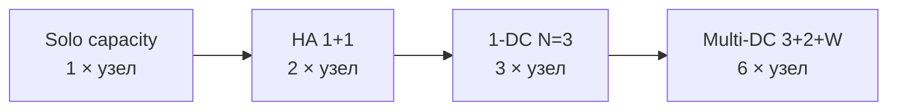

# Системные требования (low / mid / high)

Compose `env/low|mid|high.env` меняет **только heap JVM**. Эта страница переводит тиры в бюджеты **RAM / CPU / диск** по топологиям.

Цифры — **планировочные полы**, не гарантия living TPS. Потолки пропускной способности — в [ёмкости и SLO](../../performance/capacity-slo.md). После роста датасета или WAN — переизмерить.

## База evidence (1-DC N=3, mid)

Замер mid-тира (`-Xmx2g`), `hydrate-mode: LAZY`, `fsync: true`, idle после лёгкого smoke-трафика.

| Сигнал | Writer | Replica A | Replica B |
|--------|-------:|----------:|----------:|
| Process RSS | ≈1,17 GiB | ≈1,11 GiB | ≈1,10 GiB |
| Heap max (`G1 Old Gen` max) | 2 GiB | 2 GiB | 2 GiB |
| Non-heap used | ≈85–90 MiB | ≈85–90 MiB | ≈85–90 MiB |
| Working set | 0 / 65536 | 0 / 65536 | 0 / 65536 |
| `dataDir` всего | ≈842 MiB | ≈828 MiB | ≈822 MiB |
| OpLog | ≈839 MiB | ≈825 MiB | ≈819 MiB |
| Sealed | ≈2,9 MiB | ≈2,9 MiB | ≈2,9 MiB |
| Process CPU (доля хоста) | ≈0,06 | ≈0,06 | ≈0,06 |
| `orchid_r` | ≈1,0 | ≈1,0 | ≈1,0 |

Сумма RSS кластера ≈ **3,3 GiB** на трёх mid-узлах. Класс хоста замера совпадает с lab host в [capacity SLO](../../performance/capacity-slo.md) (≈64 GiB RAM, 16 logical CPU).

**Вывод базы:** idle mid-узел ≈ **1,1 GiB RSS** при **Xmx=2g**; диск держит в основном **хвост OpLog**, пока seal не truncate; sealed может быть крошечным при большом журнале. Диск планировать как journal + sealed + archive.

## Тиры нагрузки (JVM)

Те же ручки, что `examples/compose/*/env/*.env`:

| Тир | Heap в `JAVA_TOOL_OPTIONS` | Назначение |
|-----|----------------------------|------------|
| **low** | `-Xms512m -Xmx1g` | Smoke, CI, пустой/малый каталог |
| **mid** | `-Xms1g -Xmx2g` | Dev / повседневный HA (совпадает с базой выше) |
| **high** | `-Xms2g -Xmx4g` (+ G1) | Load / QG / попытки living floors на спокойном хосте |

RSS под нагрузкой **≠** `Xmx`. Держать host RAM ≈ **1,5×–2× `Xmx` на узел**, чтобы влезли GC, Metaspace, Netty/direct и окна sealed mmap. Заполненный `working-set-max-entries` (по умолчанию adaptive **65536**) добавляет RAM карты/индексов сверху idle-базы.

## Бюджет на один процесс Grid

| Ресурс | low | mid | high |
|--------|-----|-----|------|
| Heap (`Xmx`) | 1 GiB | 2 GiB | 4 GiB |
| Host RAM под процесс | ≥2 GiB | ≥3–4 GiB | ≥6–8 GiB |
| vCPU | ≥2 | ≥4 | ≥8 |
| Локальный NVMe (ОС + свободный `dataDir`) | ≥10 GiB | ≥20 GiB | ≥50 GiB + dataset×2 |
| Тип диска | SSD | NVMe | NVMe (путь fsync) |
| JDK | 25 + `--enable-preview` | то же | то же |

CPU: durable write TPS упирается в **ORCHID + OpLog fsync**, а не в свободные ядра. Лишний CPU помогает AQE/сканам и снимает конкуренцию с ORCHID tick; WRITE floors сам по себе не удваивает. Living HA floors снимались на ~10 ядер / 16 потоков для **двух** узлов — [capacity SLO](../../performance/capacity-slo.md).

Диск: у каждого voter свой **`dataDir`** (без общего NFS). Заложить хвост OpLog + поколения sealed + опциональный PITR archive. База ~0,8 GiB OpLog при ~3 MiB sealed — норма до truncate; production нельзя считать «только sealed».

## По топологиям (итог кластера)

Умножайте строку «на узел» на число процессов. Witness (multi-site) — полноценная JVM того же тира, если специально не урезаете heap; для claim quorum всё равно закладывайте **≥ mid**.

| Топология | Процессы | low (RAM / vCPU / свободный диск) | mid | high |
|-----------|----------:|-----------------------------------|-----|------|
| Solo durable (`capacity`) | 1 | ≥2 GiB / 2 / 10 GiB | ≥4 GiB / 4 / 20 GiB | ≥8 GiB / 8 / 50 GiB+ |
| HA 1+1 (`primary`+`replica`) — Load living floors | 2 | ≥4 GiB / 4 / 20 GiB | ≥8 GiB / 8 / 40 GiB | ≥16 GiB / 16 / 100 GiB+ |
| HA 1-DC N=3 (повседневный HA / hand-off) | 3 | ≥6 GiB / 6 / 30 GiB | ≥12 GiB / 12 / 60 GiB | ≥24 GiB / 24 / 150 GiB+ |
| Multi-DC ASYNC (3+2+Witness) | 6 | ≥12 GiB / 12 / 60 GiB | ≥24 GiB / 24 / 120 GiB | ≥48 GiB / 48 / 300 GiB+ |
| Multi-DC SYNC (3+2+Witness) | 6 | те же RAM/CPU/диск, что ASYNC | то же | то же; плюс **низкий WAN RTT** для digest voters |

Итоги — **сумма бюджетов узлов** или **на VM**, если узлы разнесены. Три mid-узла ≈12 GiB планировочной RAM под Grid; idle-база выше заняла ≈3,3 GiB RSS при запасе ОС на хосте класса 64 GiB.

*Схема 1. Число процессов масштабирует один и тот же per-node тир.*

## Порты и сеть

| Путь | Порты по умолчанию | Заметка |
|------|--------------------|---------|
| SQL | 15432+ | Клиент `grid://` / tooling JDBC |
| Репликация | 5615+ | Не публиковать наружу; это не SQL |
| Actuator | 7777+ | Readiness / Prometheus (профиль может переназначить) |

Multi-DC **SYNC_VOTERS_ACROSS_DC** добавляет WAN RTT к каждой записи; сначала размерьте сеть и remote voters, потом поднимайте heap-тир. ASYNC оставляет commit локальным и платит RPO.

## Чем эти цифры не являются

| Утверждение | Как на самом деле |
|-------------|-------------------|
| «low/mid/high = тиры living TPS» | Тиры задают JVM/host; TPS floors требуют спокойный Load на **primary+replica** |
| «N=3 mid даст WRITE≈4442» | Living WRITE/READ/CAPACITY floors определены на starter **1+1**, не на N=3 — [capacity SLO](../../performance/capacity-slo.md) |
| «Диск = размер sealed» | OpLog может доминировать до seal+truncate; archive растёт без ротации |
| «Idle RSS = production RAM» | Заполните working set, поднимите concurrency, снова снимите RSS и `ws_size` |

## Как перештамповать

1. Поднять топологию; дождаться readiness и одного `writerEligible=true`.
2. На каждом узле: process RSS, `jvm_memory_*`, `grid_durability_ws_*`, du `dataDir` (oplog vs sealed).
3. Опционально: спокойный Load только на **1+1**, если заявляете living floors.
4. Обновить таблицу evidence на этой странице при смене класса хоста или heap-тиров.

Heap в Compose: [развёртывание compose](deploy-compose.md). Чек-лист перед промом: [production checklist](../../getting-started/production-checklist.md).

English: [system-requirements.md](../../../en/configure-and-operate/operations/system-requirements.md).
